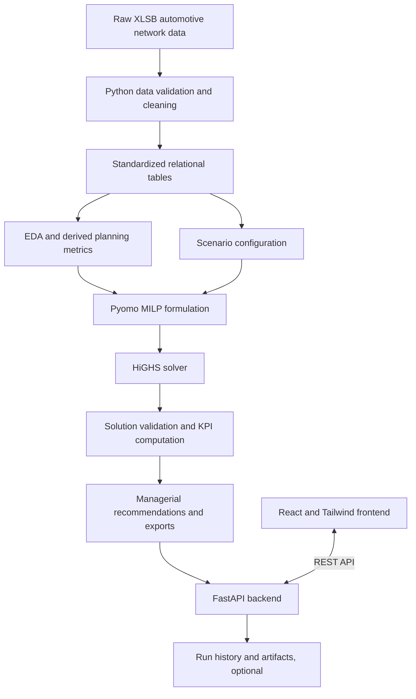

# ResiliPlan AI

## Problem Statement and Proposed Solution Architecture

**Domain:** Automotive Manufacturing Supply Chain Analytics  
**Project type:** Prescriptive decision-support web application  
**Course:** Supply Chain Analytics, PGDM–BDA 2026–27, Goa Institute of Management  
**Core analytical method:** Mixed-Integer Linear Programming (MILP)  
**Optimization stack:** Pyomo + HiGHS (free, open-source)  
**Document status:** Planning blueprint — subject to dataset audit and instructor approval

---

## 1. Executive Summary

Automotive manufacturing depends on tightly coordinated production and material flows across original equipment manufacturers (OEMs), Tier-1 suppliers and Tier-2 suppliers. A disruption at an upstream node can propagate through the bill of materials (BOM), inventory positions, production capacities and transport links, ultimately causing delayed customer orders and increased operational cost.

**ResiliPlan AI** is a proposed interactive decision-support system that will model an automotive multi-echelon supply chain and recommend feasible production, inventory and material-flow decisions under normal and disrupted conditions. Its analytical core will be a time-indexed MILP implemented in **Pyomo** and solved with the **HiGHS** solver. Scenario analysis will let a manager compare baseline operations with supplier delays, capacity reductions, transport disruptions and demand changes.

The project will prioritize **correctness, interpretability, operational feasibility and business decisions** over unnecessary model complexity. Optional predictive modelling will be added only if sufficient data supports it and it demonstrably improves planning decisions.

## 2. Business Context

### 2.1 Supply chain setting

The targeted setting is a multi-tier automotive production network comprising:

- **Tier-2 suppliers:** manufacture or supply upstream components.
- **Tier-1 suppliers:** manufacture assemblies and intermediate products, using components from upstream suppliers.
- **OEM/manufacturing nodes:** manufacture or assemble finished vehicles/products.
- **Inventory and transportation links:** connect production stages across time, subject to stock availability, transport capacity and lead times.
- **Customers:** generate product demand with required fulfilment periods.

**Material flow:** Tier-2 → Tier-1 → OEM → customers.  
**Information flow:** demand, inventory, planned production, capacities and disruption information inform the planning system.  
**Financial flow:** procurement, production, transport, inventory holding, expedited recovery and shortage-related costs are reflected in the planning objective where supported by data or documented assumptions.

### 2.2 Business challenge

Supplier unreliability, constrained production capacity, transport lead times and demand fluctuations can produce cascading disruptions. Purely descriptive dashboards show *where* shortages or delays occur, but do not necessarily determine *how the manufacturer should respond* while respecting interdependent component requirements and resource constraints.

### 2.3 Intended decision maker

**Primary:** Head of Supply Chain Planning / Manufacturing Operations.  
**Secondary:** Production planner, materials manager, procurement manager and logistics planner.

## 3. Formal Problem Statement

> **Develop an explainable, scenario-based prescriptive analytics application for a multi-tier automotive manufacturing network that determines feasible, cost-efficient production quantities, inventory allocations and inter-node material flows over a finite planning horizon, while respecting bill-of-material dependencies, production and transportation capacities, inventory availability, lead times and customer demand. The application must evaluate realistic disruptions, quantify changes in cost and service performance, and recommend operational recovery decisions for supply-chain managers.**

### 3.1 Central business question

**Given customer demand, starting inventory, material dependencies, supplier availability, capacity and transport lead times, what should each node produce, retain and transfer — and when — to minimize operational and disruption costs while protecting customer deliveries?**

### 3.2 Research question

To what extent can scenario-based MILP optimization improve production continuity and customer-order fulfilment under supplier and capacity disruptions compared with a clearly defined baseline planning policy?

### 3.3 Project objectives

1. Construct a validated, reproducible representation of the manufacturing network.
2. Understand demand, inventory, BOM structures, material flows, capacities and lead times through EDA.
3. Formulate and solve a time-indexed production–inventory–transport optimization model.
4. Measure exposure to supplier, transport, production and demand disruption scenarios.
5. Compare optimized recovery plans with a defined baseline policy using cost, service and operational KPIs.
6. Deliver recommendations through a functional, interactive full-stack decision-support application.

### 3.4 Scope boundaries

**In scope:** a manageable, connected and BOM-consistent subset of the automotive network; the dataset's 14-period demand window where applicable; production, inventory, transport and customer-service decisions; scenario analysis; interpretability and validation.

**Potential extensions:** stochastic/two-stage optimization, Monte Carlo stress testing, supplier reliability estimation, multiobjective optimization and rolling-horizon planning.

**Not automatically in scope:** ML models without sufficient training history; live supplier integrations; real-time ERP ingestion; unverified savings claims; industrial-scale optimization of every product in the full dataset at the outset.

## 4. Dataset and Data Governance

### 4.1 Primary dataset

**Dataset:** *2020_dataset_OfAutomotiveProductionNetwork.xlsb*  
**Publication/source:** Mendeley Data — *Optimisation Model for Multi-Item Multi-Echelon Supply Chains with Nested Multi-Level Products*  
**Link:** https://data.mendeley.com/datasets/pr3sdy5vp3/1  
**DOI:** https://doi.org/10.17632/pr3sdy5vp3.1

The uploaded workbook was previously reviewed in the project discussion and described as containing the following worksheets:

| Worksheet | Proposed analytical role |
|---|---|
| `products` | Product identifiers, groups and product attributes |
| `nodes` | Manufacturing and inventory nodes |
| `nodes_inflow` | Allowed/associated inbound products at nodes |
| `arcs` | Network links and transportation lead times |
| `capacity_at_arc` | Transport/link capacity by period |
| `max_flow_product_per_arc` | Product-specific flow information or limits, subject to semantic verification |
| `max_flow_group_per_arc` | Product-group flow information or limits, subject to semantic verification |
| `operations` | Manufacturing transformations and input/output relationships |
| `BOM` | Component-to-parent material requirements |
| `demands` | Customer demand by product and period |
| `initial_inventories` | Starting inventory, safety and maximum stock values |
| `initial_flows` | Materials already moving through the network |

**Audit caveat:** The previous discussion reported 12 nodes, 11 arcs, approximately 28,049 products and 87,059 BOM relationships, and a demand horizon corresponding to periods 61–74. These counts and the exact meaning of every field must be **reproduced and confirmed by the formal data audit** before they are used as validated results in the final report. Some flow-related tables may have different period coverage.

### 4.2 Critical data checks

- Missing values, invalid types, duplicate keys and broken references between tables.
- Consistency of product IDs, node IDs, arc endpoints, groups and time periods.
- BOM coefficient validity, transformation logic, cycles and dependency closure.
- Units of product quantities, production resources, inventory and arc capacity.
- Treatment of safety stock, initial inventory and in-transit material.
- Interpretation of `planned_flow` versus actual binding capacities.
- Coverage of all needed model parameters and any gaps in cost information.

### 4.3 Cost and risk assumptions

The proposed optimization uses production, transport, holding, expediting and shortage costs. **Do not assume these are available in the workbook.** Any missing economic parameters must be sourced independently where possible, otherwise estimated transparently with stated units, rationale and sensitivity ranges.

Disruption frequencies, lead-time distributions and supplier failure probabilities must **not** be portrayed as observed historical outcomes unless supported by data. Synthetic scenario inputs must be labelled as such.

### 4.4 Reproducibility

Preserve the raw workbook untouched. Generate versioned cleaned tables, a data dictionary, transformation logs, validation tests, scenario configuration files and fixed random seeds where simulation is used. Ensure that every recommendation can be traced back to model inputs and solver outputs.

## 5. End-to-End Solution Methodology

The agreed pipeline is organized as follows. The optimization formulation begins conceptually during problem framing, but its full implementation follows data understanding and validation.

| Phase | Activity | Key output |
|---|---|---|
| **0** | Business understanding, objectives, feasibility and KPI definition | Approved problem and initial mathematical specification |
| **1** | Data audit and cleaning | Validated raw-to-clean transformation pipeline |
| **2** | Standardization and selective aggregation | Consistent relational model and connected subset |
| **3** | Exploratory Data Analysis (EDA) | Network, BOM, demand, inventory and capacity insights |
| **4** | Feature/scenario engineering, if justified | Derived planning metrics and scenario configurations |
| **5** | Predictive modelling, only if justified | Validated forecasts or risk estimates with uncertainty |
| **6** | Mathematical modelling and solver implementation | Pyomo MILP solved using HiGHS |
| **7** | Model validation, scenario analysis and final decision logic | Feasible recovery plans, KPIs and recommendations |
| **8** | Full-stack development and integration | React + FastAPI decision-support application |
| **9** | Deployment, end-to-end testing and documentation | Working app, reproducible files and project report |

### 5.1 Data preparation

Cleaning will not delete inconvenient BOM relationships or artificially remove operational constraints. Aggregation will be permitted only where it preserves the component structure, time dynamics and conservation equations required for optimization.

### 5.2 EDA and derived features

Potential analytical views include node and arc connectivity, BOM depth, component criticality, inventory coverage, demand-to-capacity ratios, utilization and lead-time exposure. These are **candidate features**, subject to field availability and meaningful definitions.

### 5.3 Predictive modelling: conditional, not mandatory

The primary course method is prescriptive optimization. The available 14-period planning horizon should not be mistaken for a long historical time series suitable for training a reliable demand forecaster. Introduce prediction only if additional credible historical data is obtained or a specific supported estimation task emerges. Otherwise, use explicitly defined deterministic and stress-test scenarios.

## 6. Mathematical Optimization Architecture

### 6.1 Core method and solver

- **Modelling framework:** Pyomo.
- **MILP solver:** HiGHS via `highspy` / Pyomo integration.
- **License strategy:** free and open-source; no Gurobi academic-license dependency.
- **Primary course alignment:** prescriptive analytics (CLO 5).

### 6.2 Sets and indices (illustrative)

- \(i,j \in N\): manufacturing or inventory nodes.
- \((i,j) \in A\): permitted directed transportation arcs.
- \(p \in P\): products/components.
- \(t \in T\): planning periods.
- \(o \in O\): production operations or BOM transformations, where applicable.

### 6.3 Proposed decision variables

| Symbol | Meaning |
|---|---|
| \(x_{i,p,t}\) | Quantity of product \(p\) produced at node \(i\), period \(t\) |
| \(y_{i,j,p,t}\) | Quantity dispatched from \(i\) to \(j\) in period \(t\) |
| \(I_{i,p,t}\) | End-of-period inventory of \(p\) at node \(i\) |
| \(b_{p,t}\) | Unmet demand or backorder balance, consistently defined across periods |
| \(e_{i,j,p,t}\) | Optional expedited or emergency flow |
| \(z_{i,p,t}\) | Optional binary production/setup activation variable, only if justified |

The final formulation may use **operation-indexed production variables** instead of a simple product-indexed representation, depending on the workbook's `operations` and `BOM` semantics.

### 6.4 Proposed objective

Minimize the total cost of production, transport, inventory holding, shortages/backorders and optional expediting:

\[
\min Z = C_{\mathrm{production}} + C_{\mathrm{transport}} + C_{\mathrm{holding}} + C_{\mathrm{shortage}} + C_{\mathrm{expediting}}.
\]

Cost terms will be expanded into weighted sums across relevant products, locations and periods after the data dictionary and units are confirmed. The objective may be augmented with service-level goals or priorities, but such changes must be explicitly justified.

### 6.5 Constraint families

1. **Material conservation:** beginning inventory + arrivals + production outputs = consumption + dispatches + ending inventory, accounting for BOM and manufacturing transformations.
2. **BOM/operation feasibility:** each production operation consumes required inputs in the prescribed ratios.
3. **Production capacity:** manufacturing activity cannot exceed node/resource capacity for any period.
4. **Transportation capacity:** shipments respect arc capacity and any product/group-specific restrictions.
5. **Lead times:** dispatched quantities become available only after transit time; initial in-transit shipments are accounted for.
6. **Inventory bounds:** nonnegative inventory and justified upper/safety-stock bounds.
7. **Demand/backorder balance:** deliveries, new demand and outstanding orders reconcile without double counting.
8. **Logical/integrality constraints:** binary decisions only for genuinely discrete actions, such as setups or fixed-charge activation.
9. **Disruption constraints:** scenario-specific reductions in production/transport capacity or changes in lead time and demand.

**Important:** Slack/shortage variables allow the system to report a physically feasible recovery plan when demand cannot all be met; they must carry appropriate penalties and clear managerial interpretation.

### 6.6 Validation

Before scaling the instance:

- Solve a tiny instance with a hand-checkable answer.
- Check flow conservation and component usage independently of the optimizer.
- Verify all capacity, inventory, lead-time and customer-service equations.
- Record solver termination, feasible incumbent, objective and MIP gap.
- Distinguish optimal, feasible-but-not-proven-optimal, infeasible and time-limited results.
- Compare with a simple transparent baseline planning policy; never invent cost savings.

## 7. Scenario-Based Decision Intelligence

### 7.1 Initial scenarios

| Scenario | Input change | Managerial question |
|---|---|---|
| Baseline | Nominal demand and capacities | What is the least-cost feasible plan? |
| Supplier disruption | Reduce selected supplier production capacity | Which downstream orders are affected, and how should production adapt? |
| Material delay | Increase lead time on selected arcs | What inventory and shipment adjustments mitigate late arrivals? |
| Demand surge | Increase demand for selected products/periods | Which orders can still be fulfilled? |
| Transport constraint | Reduce capacity of a selected arc | Which material flows should be reprioritized? |
| Emergency response (if modelled) | Enable optional expedited flow at a premium | Is the recovery cost justified by service improvement? |

### 7.2 Business outputs

- Revised production plan by product, node and period.
- Planned inter-node shipments and material receipts.
- Predicted ending inventories and emerging component shortages.
- Backorders, late orders and on-time delivery performance.
- Baseline versus scenario total cost and cost breakdown.
- Bottleneck and supplier-dependency insights.
- Concise recommendations with assumptions and solver quality clearly shown.

### 7.3 Advanced option

After validating the deterministic MILP, consider Monte Carlo stress tests or a true two-stage stochastic model. **A collection of independently optimized scenarios is not equivalent to two-stage stochastic optimization**: two-stage models must explicitly link shared first-stage decisions across scenarios.

## 8. Full-Stack Solution Architecture



### 8.1 Layer responsibilities

| Layer | Proposed technology | Responsibility |
|---|---|---|
| Data ingestion | Python, Pandas | Read XLSB, validate schema, clean and transform |
| Analytics | Pandas, NumPy, Plotly | EDA, network summaries and derived metrics |
| Scenario engine | Python | Apply configurable disruption inputs |
| Optimization | Pyomo + HiGHS | Construct and solve MILP |
| Model service | FastAPI | Validate requests, orchestrate solves, return structured results |
| UI | React + Tailwind CSS | Uploads, controls, charts, recommendations and downloads |
| Visualization | Recharts / Plotly | Cost, inventory, capacity and network visuals |
| Storage (optional) | SQLite/PostgreSQL | Store scenarios, run metadata and results if justified |
| Deployment | Suitable Python-capable host | Run backend and solver; publish accessible frontend |

The **optimization engine runs server-side**, not in the browser. The frontend sends validated scenario parameters; the backend constructs the scenario, runs the solver, verifies status, computes KPIs and responds with structured JSON.

### 8.2 Proposed application pages

1. **Overview / business context:** system map, network structure, supply-chain strategy and trade-offs.
2. **Data management:** upload or load sample data; validation and data dictionary.
3. **Supply-chain explorer:** product dependencies, nodes, arcs, demand and inventory.
4. **Scenario lab:** modify disruption assumptions and solver settings.
5. **Optimization results:** baseline/scenario comparisons and operational recommendations.
6. **Explainability and validation:** assumptions, objective components, binding constraints, solver status and limitations.
7. **Reports:** downloadable tables and management summary.

### 8.3 End-user flow

```text
Load verified sample data or upload a compatible dataset
    → inspect network and baseline KPIs
    → configure disruption scenario
    → run optimization
    → review solver status and feasible decisions
    → compare with baseline
    → download recovery plan and summary
```

### 8.4 App safeguards

- Use strict data/schema/range validation with actionable error messages.
- Include working sample data so evaluators can test the app immediately.
- Enforce time/memory limits and problem-size limits for solver requests.
- Do not present outputs as optimal unless the solver confirms optimality.
- Handle infeasible/failed runs clearly, without fabricating recommendations.
- Label assumed economic and disruption parameters.
- Document hosting availability and retain reproducible solver inputs and results.

## 9. Evaluation Framework

| Dimension | Candidate measures |
|---|---|
| Cost | Total operational cost, disruption premium, breakdown by cost category |
| Service | On-time fulfilment, backorder units, delayed order periods |
| Operations | Production utilization, transport utilization, bottleneck exposure |
| Inventory | Ending stock, shortages, stock coverage and safety-stock violations where permitted |
| Resilience | Service degradation and recovery cost under disruptions |
| Solver quality | Solve time, status, MIP gap, numerical/constraint validation |
| Product usability | Input validation, scenario reproducibility, clear recommendations and exports |

Improvement will be measured **against a defined baseline heuristic/policy**, with the exact metric formulas and assumptions disclosed. No predetermined numerical benefit is assumed.

## 10. Delivery Roadmap and Acceptance Gates

| Gate | Exit criterion |
|---|---|
| **G0 — Problem approved** | Five-problem shortlist and evidence, context, core method and app plan approved by instructor |
| **G1 — Data ready** | Dataset audit complete; data dictionary and integrity tests pass |
| **G2 — Model scope frozen** | Connected BOM-consistent subset, horizon, units, costs and constraints documented |
| **G3 — MILP validated** | Tiny-instance tests pass and baseline solves with verified material balances |
| **G4 — Scenarios verified** | Scenario outputs are reproducible and business comparisons are meaningful |
| **G5 — Full stack integrated** | Upload → solve → recommendations → export works end to end |
| **G6 — Submission ready** | App accessible; model files, report, user guide, AI disclosures and test cases complete |

## 11. Deliverables

In alignment with the course guidelines:

1. A working, accessible interactive application with a sample dataset and validated new inputs.
2. All source code and reproducible model/data-preparation files.
3. Cleaned/model-ready datasets, blank templates where applicable and documented data dictionary.
4. Scenario and solver validation test cases.
5. An approximately **10–15-page** project report covering context, strategy, model, assumptions, validation, results, app design, user guide, limitations and technology outlook.
6. Transparent AI-assistance disclosure and citations to dataset and external evidence.

## 12. Risks, Assumptions and Decisions

| Risk or open question | Proposed response |
|---|---|
| Very large product/BOM structure | Use a representative connected subset first; benchmark scaling only after model validation |
| Missing cost parameters | Use documented estimates and sensitivity intervals, not invented factual costs |
| Ambiguous dataset columns | Verify semantics against published documentation and workbook relationships |
| Insufficient history for ML | Omit predictive models or obtain independent historical data |
| Computational burden | Prefer sparse indexing, eliminate unnecessary binaries and impose solve limits |
| Incorrect BOM or transit handling | Unit-test small instances and independently audit balances |
| Disruption scenario realism | Separate observed inputs from synthetic stress-test assumptions |
| App performance/hosting | Keep solver server-side and validate on target deployment environment |

## 13. Agreed Project Decisions

- **Project:** ResiliPlan AI — multi-tier automotive manufacturing supply-chain recovery planning.
- **Dataset:** Mendeley automotive production network workbook (`.xlsb`).
- **Primary method:** prescriptive optimization using time-indexed MILP.
- **Solver stack:** **Pyomo + HiGHS**, replacing Gurobi to avoid licensing friction.
- **Workflow:** business framing → data cleaning → standardization/aggregation → EDA → conditional feature engineering → optional ML → MILP → validation/business recommendations → full-stack app → deployment/report.
- **Frontend/backend:** React + Tailwind; FastAPI.
- **Design principle:** meaningful, explainable decisions; no unnecessary ML and no unsupported claims.

## 14. Immediate Next Action

**Conduct the formal workbook audit** before selecting the final MILP indexes and generating a representative network subset. Confirm worksheet columns, primary/foreign keys, units, period coverage, BOM/operation semantics, capacity meaning, cost availability and connected product families. Record findings in a dataset audit and data dictionary. Only then finalize the production model and constraint implementation.

---

## References and project basis

1. Goa Institute of Management. *PGDM–BDA 2026–27, Supply Chain Analytics: Course Project Guidelines.* User-provided course document.
2. Moetz, Quetschlich & Otto. (2020). *Optimisation Model for Multi-Item Multi-Echelon Supply Chains with Nested Multi-Level Products* [Dataset]. Mendeley Data. https://doi.org/10.17632/pr3sdy5vp3.1
3. Pyomo documentation: https://pyomo.readthedocs.io/
4. HiGHS optimization software: https://highs.dev/

*This is a proposed design, not a statement that optimization or scenario benchmarking has already been completed.*
